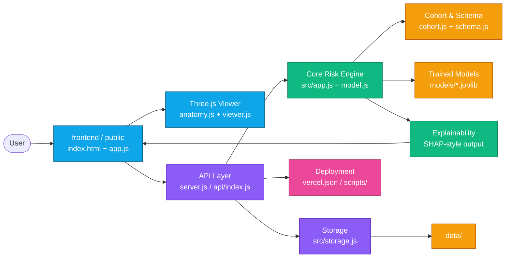

<div align="center">
  <h1>CardioVision-AI</h1>
  <p><strong>3D Coronary Risk Explorer</strong></p>
  <p>
    
    <a href="https://aws.amazon.com/certification/certified-solutions-architect-associate/">
      
    </a>
    <a href="https://cardio-vision-ai-six.vercel.app/">
      
    </a>
  </p>
</div>

<div align="center">
  <video controls width="85%" poster="frontend/cardiovision-lynx-logo.svg">
    <source src="CardioVision%20by%20LYNX.mp4" type="video/mp4">
    Your browser does not support the video tag.
  </video>
</div>

<div align="center" style="margin: 18px 0;">
  <a href="https://cardio-vision-ai-six.vercel.app/" style="display: inline-block; padding: 12px 22px; border-radius: 10px; color: #ffffff; font-weight: 700; text-decoration: none; background: linear-gradient(90deg, rgb(0, 119, 255), rgb(126, 34, 206), rgb(236, 72, 153)); box-shadow: 0 0 14px rgba(126, 34, 206, 0.55);">
    Visit the CardioVision-AI Website
  </a>
</div>

CardioVision is an interactive clinical decision-support and educational platform that combines 3D anatomical coronary visualization with machine-learning-based risk estimation and permutation-sampled Shapley (SHAP-style) explainability.

---

## Architecture & Project Structure

```
CardioVision/
├── frontend/             # Interactive 3D visualization dashboard & UI
│   ├── index.html        # Entrypoint with local Three.js importmap
│   ├── style.css         # UI design system & responsive layout
│   ├── app.js            # Dashboard state, SVG charts, and API binding
│   ├── viewer.js         # Three.js 3D cardiac & coronary viewport
│   ├── anatomy.js        # Procedural coronary anatomy mesh generation
│   └── risk.js           # Multi-vessel risk classification & color scales
├── src/                  # Core application logic & risk engines
│   ├── app.js            # Express application routing & middleware
│   ├── model.js          # Clinical risk model & Shapley explanation engine
│   ├── cohort.js         # Synthetic population generator & baseline stats
│   └── schema.js         # Clinical features schema & domain mappings
├── models/               # Benchmark metrics & validation reports
│   └── metrics.json      # Cross-validation & held-out test evaluation
├── scripts/              # Local run and utility scripts
│   ├── run.bat           # Windows launcher
│   ├── run.sh            # Linux / macOS launcher
│   └── requirements-legacy-python.txt
├── data/                 # Dataset documentation & references
│   └── README.md
├── server.js             # Main server entrypoint (Local, Cloud Run, Vercel)
├── package.json          # Node.js project manifest & scripts
├── package-lock.json     # Dependency lockfile
├── vercel.json           # Vercel deployment configuration
├── metadata.json         # Platform configuration
└── .env.example          # Environment variables template
```

---

## Key Features

- **3D Anatomical Coronary Viewport**: Real-time WebGL rendering of the human heart, thoracic cage, lungs, and the primary coronary vessels (**LAD**, **LCX**, **RCA**) with interactive rotation, artery inspection, and layer toggles.
- **Multitarget Risk Prediction**: Simultaneously estimates overall coronary artery disease (**CAD**) risk along with individual vessel-specific stenosis probabilities.
- **Explainable AI (Shapley Values)**: Computes additive feature contributions (in probability points) with exact additivity, domain waterfall breakdowns, and population percentile context.
- **Zero-Dependency 3D**: Bundles Three.js locally via `/vendor/three`, running completely offline without external CDN latency.

---

## Getting Started

### Prerequisites
- Node.js 18+ (Node.js 20 or 22 recommended)
- npm

### Installation & Run

1. **Install dependencies**:
   ```bash
   npm install
   ```

2. **Start the server**:
   ```bash
   npm start
   ```

3. **Open in browser**:
   Navigate to `http://localhost:3000`.

### Quick Launchers
- **Windows**: Double-click `run.bat`
- **Linux / macOS**: Execute `./run.sh`

---

## Deployment

### Vercel
Deploy seamlessly with zero configuration:
```bash
vercel
```
The repository includes `vercel.json` and `api/index.js` configured for `@vercel/node`.

### Google Cloud Run / Docker
The application automatically binds to `0.0.0.0:${PORT:-3000}`.

---

## License

This project is distributed under the terms of the [MIT License](LICENSE).

## Disclaimer

CardioVision-AI is intended for educational, research, and demonstration purposes only. It is not a medical device and does not provide diagnosis, treatment recommendations, or emergency medical advice. Predictions and visualizations must not replace assessment by a qualified healthcare professional. Always consult an appropriately licensed clinician for medical decisions.

## 3D Project Flowchart


